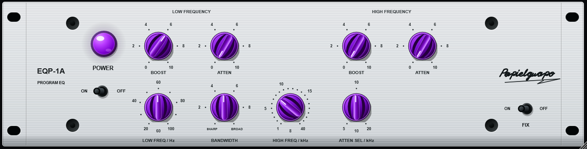

# EQP-1A — Papielguapo

Ecualizador inspirado en Pultec EQP-1A, con la estética de VCA SSL y FET 67. Windows x64: **VST3 y standalone**.



## Interfaz y controles

Panel de aluminio cepillado y mandos violeta en dos filas, sin medidor ni mando Output. Se abre siempre al 70 % (934 × 238), aunque se haya redimensionado antes. Se puede ampliar durante el uso.

- Low Frequency: 20, 30, 40, 50, 60, 70, 80, 90 y 100 Hz.
- High Frequency: 1–20 kHz en pasos de 1 kHz, más 30 y 40 kHz.
- Boost y Atten de graves independientes: permiten realzar y atenuar simultáneamente.
- Boost de agudos con Bandwidth: 0 = Sharp, 10 = Broad.
- Atten de agudos con selector de 5, 10 o 20 kHz.
- FIX: igualación automática RMS de salida respecto a entrada, enlazada en estéreo. Encendido inicialmente. Se puede apagar para conservar la ganancia propia de la EQ.
- Power: bypass de EQ y compensación con transición suave.

Los controles 0–10 indican intensidad, no dB. Arrastra o usa la rueda; doble clic restaura el valor inicial. Los selectores muestran siempre el valor elegido. Mono y estéreo, automatización y recuperación de ajustes del host.

FIX usa medición RMS de aproximadamente 300 ms y suavizado de ganancia de 150 ms, con compensación máxima de ±36 dB. Iguala el nivel medio tras estabilizarse; no es un limitador de picos ni impone igualdad muestra a muestra. No añade ruido ni saturación.

## Instalación

Descarga el ZIP de Releases, extráelo y ejecuta `Install.ps1`. Crea accesos directos en Escritorio e Inicio. El instalador intenta `C:\Program Files\Common Files\VST3`; si no dispone de permisos, usa `%LOCALAPPDATA%\Programs\Common\VST3`. El standalone se instala en `%LOCALAPPDATA%\Programs\Papielguapo\EQP-1A`.

Vuelve a escanear los plugins del DAW y busca **EQP-1A / Papielguapo**. Si el DAW no explora automáticamente la carpeta VST3 del usuario, añádela a sus rutas. El standalone permite elegir entradas y salidas en las opciones de audio; usa auriculares si activas un micrófono.

## Alcance de la emulación

DSP propio mediante filtros digitales: dos shelves de graves con frecuencias diferentes, pico de agudos con Q variable y shelf de atenuación de agudos. No incluye código de UAD ni modelado del circuito pasivo, válvulas o transformadores. No es un producto oficial y no se ha demostrado equivalencia sonora con UAD. Los pasos de frecuencia ampliados son una personalización.

Los valores 30 y 40 kHz se pueden seleccionar; la frecuencia interna se limita a 0,45 × frecuencia de muestreo. Para procesar 40 kHz sin esa limitación se necesita trabajar a 96 kHz o más.

Referencia de los controles clásicos: [manual de Universal Audio](https://help.uaudio.com/hc/en-us/articles/7183176266260-Pultec-Passive-EQ-Collection-Manual).

## Compilación y auditoría

CMake 3.22+, Visual Studio C++ y JUCE 9.0.5. Usa JUCE local en `C:/JUCE` o descarga automáticamente la versión fijada.

```powershell
cmake -S . -B build -G "Visual Studio 18 2026"
cmake --build build --config Release --parallel 2
ctest --test-dir build -C Release --output-on-failure
```

Consulta [Auditoria.md](Auditoria.md) y los informes de `Validation/`. El código de este proyecto se distribuye bajo AGPL-3.0; las dependencias mantienen sus propias licencias.
