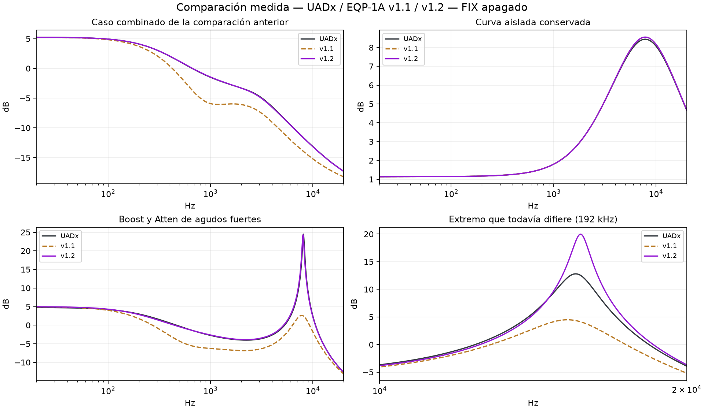

# EQP-1A — Papielguapo

**v1.4.0 · Windows x64 · VST3 y standalone · motor independiente con color sutil**


Ecualizador inspirado en EQP-1A, con skin de aluminio y mandos violeta de VCA SSL/FET 67. Cinco controles arriba y cuatro abajo, incluyendo Output como en el EQP-1A. Sin medidor. Proporción tomada del editor UADx instalado: 713 × 225. Abre siempre compacto a 428 × 135 y permite reducir a 356 × 112 o ampliar hasta 2852 × 900. Mantiene mandos circulares y dos filas.

## Color sutil de v1.4.0

Etapa simétrica de saturación suave en paralelo, después de EQ y antes de FIX. Refuerza principalmente el tercer armónico, sin generador de ruido y sin mando adicional. Output sigue después de FIX. A −6 dBFS el tercer armónico de prueba ronda −51 dBc. La rama no lineal emplea antiderivación ADAA para reducir aliasing; no lo elimina por completo. La ruta lineal mantiene su latencia. Las sesiones existentes adquieren esta coloración al actualizar.

Las comparaciones con UADx de abajo corresponden al motor lineal v1.2, antes de añadir esta etapa; no validan equivalencia armónica con UAD.

## Controles

- Graves: 20–100 Hz en pasos de 10 Hz, con Boost y Atten independientes.
- Agudos: 1–20 kHz en pasos de 1 kHz, más 30 y 40 kHz.
- Bandwidth: Sharp a Broad; afecta la anchura y la altura del realce.
- Atten Sel: 5, 10 o 20 kHz.
- Output: ganancia final de −12 a +12 dB después de FIX. FIX no contrarresta el ajuste de Output.
- FIX: igualación RMS enlazada en estéreo, activada inicialmente. Apágalo para comparar la ganancia absoluta contra UADx.
- Power: bypass con transición suave y retardo compensado.

Arrastra o usa la rueda. Haz doble clic en un mando o en su valor para escribirlo; Enter o salir del campo aplica el cambio y Escape lo cancela. Se aceptan decimales con punto o coma y unidades Hz/kHz/dB. Los selectores eligen el paso disponible más cercano; las cantidades se limitan a su rango. Escalas 0–10 de intensidad, no dB. Mono/estéreo, automatización y recuperación de ajustes. FIX mide aproximadamente 300 ms y suaviza la ganancia 150 ms, limitado a ±36 dB: iguala RMS tras estabilizarse, no los picos.

## Mejoras de v1.3.1

Proporción del UADx EQP-1A, medida directamente en el plugin instalado, con apertura pequeña y un amplio rango de escala. Todos los valores conservan la edición numérica por doble clic. Enter aplica y Escape cancela.

## Mejoras de v1.2.1

Perilla Output añadida después de la igualación FIX, con suavizado de 35 ms, valor inicial 0 dB, automatización y recuperación de estado. Power desconecta también esta ganancia. Con Output a 0 dB se conserva el motor y la calibración de v1.2.0.

## Mejoras del motor v1.2

Modelo conjunto para Boost/Atten de agudos y corrección de la carga entre atenuación de graves y agudos, a partir de 3075 medidas adicionales del UADx instalado. Diseño mediante secciones estables, con comprobación numérica y transición gradual. Se conservan las curvas aisladas de v1.1. Sin ruido, saturación ni dependencia del plugin UADx para funcionar.

Comparación de los VST3 compilados contra UADx 1.2.16, con FIX apagado y Output a 0 dB, en 20 Hz–20 kHz a 44,1/48/96/192 kHz:

| Lote | Casos | Máximo observado v1.1 | Máximo observado v1.2 |
|---|---:|---:|---:|
| Curvas aisladas anteriores | 164 | 0,263 dB | 0,263 dB |
| Combinaciones anteriores | 48 | 4,479 dB | 1,079 dB |
| Combinaciones adicionales | 160 | 20,752 dB | 1,752 dB |
| Lote final nuevo | 96 | 22,017 dB | 7,123 dB |

En las 48 combinaciones anteriores, el error RMS medio baja un 75,3 %. En el lote final nuevo baja un 73,5 %. **Todavía no es un clon 1:1**: algunas resonancias extremas siguen difiriendo y no todos los ajustes mejoran individualmente. Estas cifras corresponden a los lotes y frecuencias medidos, no son límites universales. No se han igualado fase, distorsión ni sobrecarga; el motor permanece limpio.

[Auditoría](Auditoria.md) · [Mediciones completas](Reference/Compiled-comparison.json)



## Instalación

Extrae el ZIP de Releases y ejecuta Install.ps1. Intenta instalar en `C:\Program Files\Common Files\VST3`; si faltan permisos, usa `%LOCALAPPDATA%\Programs\Common\VST3`. El standalone se instala en `%LOCALAPPDATA%\Programs\Papielguapo\EQP-1A`, con accesos directos en Escritorio e Inicio. Añade la carpeta VST3 de usuario a las rutas del DAW si fuese necesario y vuelve a escanear.

La latencia comunicada al host es 86 muestras a 44,1/48 kHz, 118 a 96 kHz y 151 a 192 kHz. El bypass mantiene el retardo. Las frecuencias extra sin posición equivalente UADx se interpolan o extrapolan; las frecuencias internas se limitan a 0,45 × sample rate. Para alcanzar 40 kHz se requiere 96 kHz o más.

## Compilación

CMake 3.22+, Visual Studio C++ y JUCE 9.0.5 local en C:/JUCE, o descargado automáticamente mediante CMake.

```powershell
cmake -S . -B build -G "Visual Studio 18 2026"
cmake --build build --config Release --parallel 2
ctest --test-dir build -C Release --output-on-failure
```

Código AGPL-3.0. Dependencias bajo sus propias licencias. Implementación independiente, sin código ni binarios de UAD. Referencia de controles: [manual de Universal Audio](https://help.uaudio.com/hc/en-us/articles/7183176266260-Pultec-Passive-EQ-Collection-Manual).
